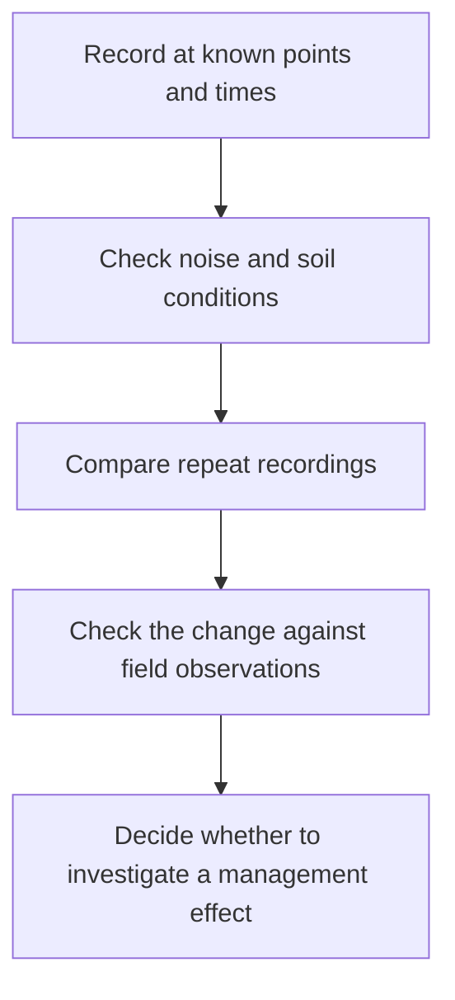

# Comparing soil acoustic monitoring systems

A farmer who wants a score after walking a field can buy Soil Acoustics’ meter and analysis service. A team that wants recordings for its own analysis can buy equipment from Elekon or Frontier Labs. Biofonic is testing a sensor that stays in one place for weeks. The cost comparison depends on whether the team needs equipment, interpretation or access to a trial. [SRC-015](sources.md#src-015), [SRC-029](sources.md#src-029), [SRC-041](sources.md#src-041), [SRC-027](sources.md#src-027), [SRC-028](sources.md#src-028)

## Systems, cost and evidence

Prices and availability were checked on **22 November 2026**. The table uses each seller’s currency. The linked sections give the tax basis, recurring costs and evidence for each system.

| System | Access | What the user receives | Listed price |
| --- | --- | --- | --- |
| [Soil Acoustics SAM](#soil-acoustics) | UK purchase | Meter, score and first year of analysis | £1,010 Light or £1,120 Standard, before VAT and delivery. [SRC-016](sources.md#src-016), [SRC-017](sources.md#src-017) |
| [Biofonic](#biofonic) | UK trial waitlist | Opportunity to test a fixed field sensor | No public price found. [SRC-028](sources.md#src-028) |
| [Elekon ALISO](#elekon) | Dutch retailer | Recorder and soil sensor | €898 including Dutch VAT. [SRC-031](sources.md#src-031) |
| [Frontier Labs BAR-LT](#frontier-labs) | Australian purchase | Recorder and separate soil microphone | A$1,280 for the pair, before tax and delivery. [SRC-041](sources.md#src-041), [SRC-042](sources.md#src-042) |

### Soil Acoustics

The operator moves the Soil Acoustic Meter (SAM) between sampling points and makes a three-minute recording at each. The portal returns the supplier’s Soil Acoustic Quality Index (SAQI) for each recording, a batch average and downloadable comparisons. The Light plan allows about 20 recordings a month and Standard about 80. At ten points per setting, that covers roughly two or eight settings per month. Annual analysis costs **£180 for Light or £290 for Standard** after the first year. [SRC-002](sources.md#src-002), [SRC-003](sources.md#src-003), [SRC-015](sources.md#src-015), [SRC-016](sources.md#src-016), [SRC-017](sources.md#src-017)

The UK shop also listed a **£830 Groundswell offer** for one meter and twelve months of Standard analysis. The listing gave no end date. Eligibility and the checkout price were unverified. [SRC-043](sources.md#src-043)

The Warwick and Baker Consultants feasibility project produced a prototype. The team reports more than 2,000 recordings, and a Hampshire farm account documents use. The public studies reviewed give no independent estimate of the error when SAQI predicts animal counts on a new farm. [SRC-008](sources.md#src-008), [SRC-009](sources.md#src-009), [SRC-010](sources.md#src-010)

### Biofonic

SoilScope is the name of Biofonic’s funded research project. Its fixed sensor collects vibrations, moisture, temperature and electrical conductivity. Biofonic describes USB, Wi-Fi or cellular data transfer and software that learns to recognise sounds. UK Research and Innovation lists **£363,879.50 in project funding**. Biofonic’s public route to access is a trial waitlist. [SRC-027](sources.md#src-027), [SRC-028](sources.md#src-028), [SRC-038](sources.md#src-038)

Biofonic reports testing 25 units across 12 fields in 2025. Riverford describes deploying a sensor to investigate underground activity, including wireworm. Neither account reports how often the system correctly identified a pest or whether it reduced crop losses. [SRC-027](sources.md#src-027), [SRC-039](sources.md#src-039)

### Elekon

The ALLSOUNDER ALISO has a soil sensor that turns vibrations into an electrical signal. The user can listen on headphones or schedule recordings to a microSD card through a Bluetooth app. The Dutch retailer Veldshop lists the recorder and sensor at **€742.15 excluding VAT**, or €898 including VAT. [SRC-029](sources.md#src-029), [SRC-031](sources.md#src-031)

Switzerland’s Sounding Soil programme lends the ALISO for private use. Borrowers pay **CHF 10.50 return postage** and the programme suggests a **CHF 25 donation**. The operator says the project ends in 2026. A separate Swiss forest study linked soil recordings to observations of soil animals. Maeder and colleagues used a custom sensor array and preamplifiers, so their results apply to that equipment. [SRC-032](sources.md#src-032), [SRC-037](sources.md#src-037)

### Frontier Labs

The **A$930 BAR-LT** includes a standard microphone. Frontier Labs also sells a JrF soil contact microphone for **A$350**, made for the recorder’s connector. The pair totals A$1,280 before tax and delivery. Batteries, storage and analysis are extra. The recorder can schedule and time-stamp files in WAV or FLAC format. [SRC-041](sources.md#src-041), [SRC-042](sources.md#src-042)

The supplier suggests research applications including termites. The public material reviewed documents equipment compatibility. It gives no test of this combination against independent animal counts or evidence of microbial identification. The Australian woodland study below used a different recorder. [SRC-041](sources.md#src-041), [SRC-034](sources.md#src-034)

## Two research alternatives with published field tests

**JrF microphone and Zoom H4n Pro recorder.** At Mount Bold in South Australia, researchers attached a JrF C-Series Pro contact microphone to an aluminium tent peg. They estimated the recording equipment cost **under A$600 in 2024**. Across 240 recordings from six woodland plots, two acoustic indices rose with the number of invertebrates counted. A related Ecoutic microphone and two probes were listed at **£65** on the review date. That price covers the microphone and probes only. The study used the earlier model, a separate recorder and the researchers’ own analysis. [Field findings and the limits of the counts](research-evidence.md#when-does-the-signal-track-the-animals-present) · [SRC-034](sources.md#src-034), [SRC-033](sources.md#src-033)

**AudioMoth in a buried tube.** In Swedish tundra, researchers installed 36 loggers facing upwards in tubes about 10 cm below the surface. Earthworm presence affected what the devices recorded, partly because soil conditions changed how sound travelled. Direct detection of daily worm activity proved difficult. A comparable AudioMoth v1.2.0 board was listed at **US$99**. Batteries, storage, field protection, tubes and analysis are separate costs. The study did not specify that board revision. [SRC-036](sources.md#src-036), [SRC-035](sources.md#src-035)

## What to compare a recording against

A quiet probe can have an earthworm beside it. To check that possibility, a farmer could record first, then dig a nearby pit and log the worm count against the same location. An English survey shows both the scale of work involved and what a hand count can miss. [SRC-048](sources.md#src-048)

In spring 2018, farmers surveyed 126 fields covering 1,318 hectares. Jacqueline Stroud’s protocol called for ten pits along a W-shaped route across each field. Each pit measured 20 cm on every side. The farmers counted adults and juveniles. They grouped the adults into surface dwellers, topsoil dwellers and deep burrowers. [SRC-048](sources.md#src-048)

Volunteers checked 27 pits from nine fields by spending a second five minutes sorting the same soil. They found another **1.6 worms per pit on average**, and 91% of those extra worms were juveniles. That second count gives a sense of what a short search can miss. The survey assessed hand counting itself. It included no acoustic equipment or test of SAQI. [SRC-048](sources.md#src-048)

## Match the output to the decision

- **To compare visits with a ready-made report**, SAM provides a score for each point and a batch average. The recording allowance determines how many settings a team can cover. The licence also affects how a team can share its results. [SAM packages and data rights](company-and-product.md#what-a-buyer-gets)
- **To collect recordings for independent analysis**, ALISO and BAR-LT offer scheduled sampling. The two research setups also leave the choice of analysis with the team. Allow time to label and check the recordings and compare results with observations from the site. [SRC-029](sources.md#src-029), [SRC-042](sources.md#src-042) · [Research on sound and animal counts](research-evidence.md)
- **To monitor for a pest over time**, Biofonic has documented field trials. A buyer would still need a price and evidence of missed detections and false alarms for the target species on new fields. [SRC-028](sources.md#src-028), [SRC-039](sources.md#src-039)

A Florida vineyard trial illustrates the difference between hearing an animal and identifying a pest. Researchers recorded at 28 vines with signs of possible infestation and dug up the roots within two hours. They found invertebrates at 27 vines and signs of grape root borer damage at 25, but recovered only one live borer larva. The acoustic assessment grouped all sound-producing invertebrates together. A sound could flag a vine for inspection. Treating it for grape root borer would require evidence of that particular pest. [SRC-052](sources.md#src-052)

Across the sources reviewed, no trial ran all these systems at the same sites against the same biological counts. A direct comparison would need to measure how well readings repeat, how closely they agree with counts, and how much staff time and money each usable field visit takes. [How to investigate a change in score](research-evidence.md#how-to-investigate-a-change-in-score)
