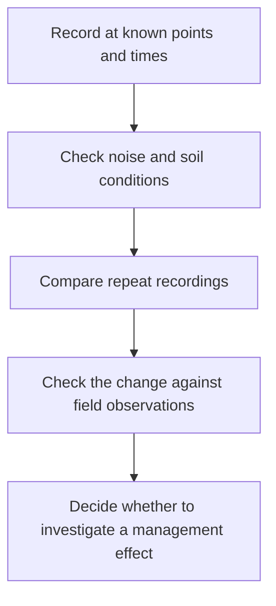

# Comparing soil acoustic monitoring systems

**Prices and evidence checked on 22 November 2026.** A farm buying its first recorder has three different choices. Soil Acoustics sells a meter with a score and reporting service. Elekon and Frontier Labs sell equipment for collecting recordings that the user can interpret. Biofonic is testing a sensor that can stay in place for weeks. These approaches answer different questions about what happens across a field and what happens over time at one point. [SRC-015](sources.md#src-015), [SRC-029](sources.md#src-029), [SRC-041](sources.md#src-041), [SRC-028](sources.md#src-028)

## Systems, cost and evidence

The prices below retain the seller’s currency. A hardware price covers only the listed components. A published field trial can show that an instrument records activity without establishing that it can identify species or measure overall soil health.

| System and availability | How it works and what comes back | Published cost and scope | Evidence for the claim |
| --- | --- | --- | --- |
| **Soil Acoustics Ltd — Soil Acoustic Meter (SAM)**. UK retail, the reference system. | An operator moves a contact probe between points. The device takes three-minute recordings. The portal returns the proprietary Soil Acoustic Quality Index (SAQI) per recording, a batch average and downloadable comparisons. | **£1,010 Light or £1,120 Standard** for one meter and the first year. Annual plans are **£180 or £290**, for about 20 or 80 recordings per month. Regular prices exclude VAT and delivery. Ten points per setting gives roughly two or eight sampled settings per month. [SRC-015](sources.md#src-015), [SRC-016](sources.md#src-016), [SRC-017](sources.md#src-017) | A funded Warwick/Baker feasibility project produced a prototype and the team reports over 2,000 recordings. A Hampshire farm pilot documents use. The public sources reviewed give no independent error bounds for SAQI against counts on new farms. [SRC-008](sources.md#src-008), [SRC-009](sources.md#src-009), [SRC-010](sources.md#src-010) |
| **Biofonic — SoilScope**. UK research and farm trial programme. | A fixed sensor collects vibrations, moisture, temperature and electrical conductivity. Biofonic describes uploads over USB, Wi-Fi or cellular networks, with machine learning for identification. SoilScope is the name of Biofonic’s funded project. [SRC-027](sources.md#src-027), [SRC-038](sources.md#src-038) | **No public equipment or subscription price found.** The public offer is a waitlist to test the system. UKRI’s **£363,879.50** is project funding and gives no basis for estimating a per-farm price. [SRC-028](sources.md#src-028), [SRC-038](sources.md#src-038) | Biofonic reports testing 25 units across 12 fields in 2025. Riverford independently describes deploying a sensor to investigate underground activity, including wireworm. These sources document field trials, but give no species-level detection errors or measured reduction in pest losses. [SRC-027](sources.md#src-027), [SRC-039](sources.md#src-039) |
| **Elekon — ALLSOUNDER ALISO**. Commercial soil recorder used by the Swiss Sounding Soil programme. | A piezoelectric soil sensor converts vibrations into an electrical signal. Users can listen through headphones or schedule recordings to a microSD card. A Bluetooth app controls the recorder. [SRC-029](sources.md#src-029) | **€898 including Dutch VAT, or €742.15 excluding VAT**, for the recorder and sensor at Veldshop. Switzerland’s private-use loan scheme lists **CHF 10.50 return postage** and a suggested **CHF 25 donation**. Its operator says the project ends in 2026. [SRC-031](sources.md#src-031), [SRC-032](sources.md#src-032) | Biovision identifies the ALISO as the device it lends, which supports its use for listening and recording. Maeder and colleagues’ Swiss forest study linked recordings to soil fauna using a **custom array and preamplifiers**. The manufacturer documents recording and playback. The paper’s findings apply to the custom array. [SRC-032](sources.md#src-032), [SRC-037](sources.md#src-037) |
| **Frontier Labs — BAR-LT with Soil Microphone**. Australian retail. | A JrF contact microphone plugs into Frontier’s proprietary connector. The recorder can schedule and time-stamp WAV or FLAC recordings. The buyer supplies the analysis method. [SRC-041](sources.md#src-041), [SRC-042](sources.md#src-042) | **A$1,280** calculated from **A$930** for the BAR-LT plus **A$350** for the soil microphone. Excludes tax, delivery, batteries, storage and analysis. The standard recorder microphone is a separate type. [SRC-042](sources.md#src-042), [SRC-041](sources.md#src-041) | The supplier documents compatibility and recording specifications and suggests research applications including termites. The public materials reviewed provide no trial that compares this exact combination with independent fauna counts or demonstrates microbial identification. Published JrF research below used a different recorder. [SRC-041](sources.md#src-041), [SRC-034](sources.md#src-034) |

**Promotional price observed.** The UK shop also displayed a Groundswell offer of **£830** for one SAM and twelve months of Standard access on 22 November 2026. The listing gave no end date. Eligibility and checkout were unverified. The table uses regular prices for comparison. [SRC-043](sources.md#src-043)

## Two research alternatives with published field tests

- **JrF contact microphone, metal peg and Zoom H4n Pro.** Robinson and colleagues attached a C-Series Pro microphone to an aluminium tent peg and used a portable recorder. They estimated the recording system at **under A$600 in 2024**. In 240 samples from six South Australian woodland plots, acoustic measures were higher in restored and remnant plots than in cleared plots, and were associated with invertebrate observations. Today the maker lists a related Ecoutic microphone and two probes for **£65**. The £65 buys the microphone and probes only. The study used the earlier microphone, separate recording hardware and researcher analysis. [SRC-034](sources.md#src-034), [SRC-033](sources.md#src-033)
- **AudioMoth in a buried tube.** Keen and colleagues placed 36 loggers facing upwards in tubes about 10 cm below the surface in a Swedish tundra experiment. Earthworm presence affected the soundscape, including through changes to sound transmission. Direct detection of daily worm activity proved difficult. A current AudioMoth v1.2.0 board is listed at **US$99**. Budget separately for batteries, storage, field protection, tubes and analysis. The retail board price is a procurement reference for a comparable logger, rather than a price for the original experiment. [SRC-036](sources.md#src-036), [SRC-035](sources.md#src-035)

## What to compare a recording against

Finding an earthworm beside a quiet probe confirms that at least one worm was present. In spring 2018, farmers surveyed 126 English fields covering 1,318 hectares. Following Jacqueline Stroud’s protocol, they dug ten pits per field along a W-shaped route. Each pit measured 20 cm on every side. They counted adults and juveniles and sorted the adults into surface-dwelling, topsoil-dwelling and deep-burrowing groups. [SRC-048](sources.md#src-048)

To investigate a quiet patch, take the recording first, then dig a pit nearby and record the worm count against the same location. Allow for worms the sort can miss. When volunteers spent a second five minutes sorting soil from 27 pits on nine fields, they found another 1.6 worms per pit on average. Of those extra worms, 91% were juveniles. This gives the farmer a separate observation of earthworm presence. Stroud’s survey included no acoustic equipment or test of the commercial SAQI score. [SRC-048](sources.md#src-048)

## Match the output to the decision

- **For repeat visits with a ready-made report**, SAM has a published first-year price and recurring analysis cost. Check whether the available recording allowance and data rights cover the intended work. [Product and data rights](company-and-product.md)
- **For unattended or reproducible audio collection**, ALISO, BAR-LT and the research arrangements allow the team to select sampling windows and an analysis method. Budget for staff time to label and check recordings. The resulting indices need validation for the site and question. [SRC-029](sources.md#src-029) · [Field evidence](research-evidence.md)
- **For continuous pest surveillance**, Biofonic has documented trials and an open expression of interest. A procurement decision needs a price and a species-specific evaluation, including missed detections and false alarms on previously unseen fields. [SRC-028](sources.md#src-028), [SRC-039](sources.md#src-039)

A Florida vineyard study shows what a pest alert needs to establish. Researchers listened at 28 vines showing possible infestation, then dug up the roots within two hours. They found invertebrates at 27 vines and signs of grape root borer damage at 25. They recovered just one live borer larva. Their acoustic assessment grouped together all invertebrates capable of making sound. For a grower, such a signal can flag a vine worth inspecting. Choosing a treatment for grape root borer requires evidence that this particular pest is present. [SRC-052](sources.md#src-052)

Across the sources reviewed, no head-to-head trial ran all these systems at the same sites against the same biological reference. A price ranking would therefore combine different deliverables. A useful common test would compare repeatability, agreement with independent counts, operator time and total cost per usable field visit. [Interpreting recordings and field comparisons](research-evidence.md)
